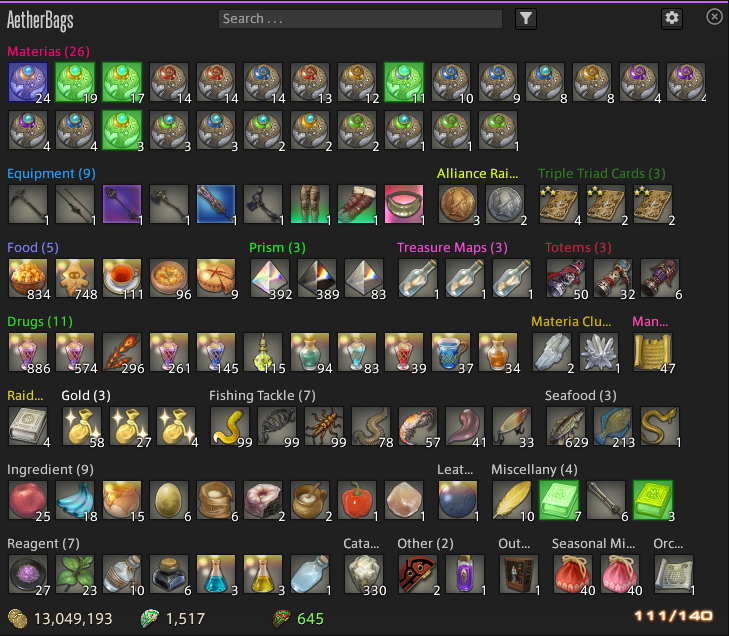

# AetherBagsEx

一个 Final Fantasy XIV 的 Dalamud 插件，用于整理和展示背包内容。

所有界面均由**游戏原生 UI 元素**构建 —— 这得益于 [KamiToolKit](#基于-kamitoolkit-构建)：
它让 C# 插件能够直接操作游戏的 ATK 节点树，因此界面在外观、字体、贴图、动画、
手柄导航与音效上与游戏原生界面完全一致，而非外挂式的 ImGui 窗口。

支持自定义分类：名称、顺序与优先级、颜色，以及基于规则的物品过滤
（物品 ID、名称模式、UI 分类、稀有度、等级 / 物品等级、商人价格、各类标记位等）。



[](https://github.com/Zeffuro/AetherBags)

---

## 目录

- [主要功能](#主要功能)
- [基于 KamiToolKit 构建](#基于-kamitoolkit-构建)
  - [为什么选择 KTK](#为什么选择-ktk)
  - [KTK 的功能范围](#ktk-的功能范围)
  - [本插件的能力覆盖](#本插件的能力覆盖)
- [项目结构](#项目结构)
- [构建](#构建)

---

## 主要功能

### 多窗口

插件提供 7 个独立窗口，全部使用游戏原生窗口框架，可分别开关、调整尺寸并记忆位置：

| 窗口 | 说明 |
| --- | --- |
| 背包 | 主窗口，带分类网格与页脚货币条 |
| 鞍包 | 坐骑包 |
| 随从 | 随从与随从陆行鸟包 |
| 军装库 | 按职业角色分组的军装库视图 |
| 公司仓库 | 公司仓库物品 |
| 配置 | 分类、规则、样式、外部分类源等设置 |
| 更新日志 | 版本变更记录 |

每个窗口均可选择「随游戏背包一同打开」与「隐藏游戏原版窗口」。

### 分类与规则

- **用户自定义分类**：名称、颜色、图标、显示顺序与优先级，分类可折叠、可固定。
- **规则过滤**：按物品 ID、名称匹配、UI 分类、稀有度、等级 / 物品等级、商人价格、
  物品标记位等条件自动归类，支持规则分组与来源排序。
- **职业匹配**：军装库分类可按当前职业高亮（职业专属分类显示金色标题）。
- **堆叠处理**：可按物品 ID 聚合堆叠，并可选择是否聚合不可堆叠物品。
- **紧凑打包**：物品网格支持紧凑排布，可调预读距离与「优先最大格」策略。

### 交互

- **拖放整理**：在分类之间拖动物品即完成转移与归类，支持拖到分类前后排序、
  拖出到当铺 / 仓库 / 丢弃。
- **搜索**：全局搜索框，支持高亮匹配模式；搜索可触发分类过滤。
- **最近拾取物**：可单独显示「最近拾取」分类，并以可配置颜色高亮未读物品。
- **货币条**：页脚显示已启用货币的图标与数量。
- **链接物品**：可将物品链接到聊天频道。

### 外部集成

- **IPC API**：向其它插件暴露分类查询与刷新事件（`AetherBagsAPI`）。
- **外部分类源**：支持从外部插件导入分类（统一外部分类开关）。
- **DTR 条**：在游戏设置界面中提供额外配置入口。
- **本地化**：内置多语言（`loc/`），跟随游戏语言设置。

---

## 基于 KamiToolKit 构建

### 为什么选择 KTK

在 Dalamud 生态里，插件界面通常走 ImGui —— 它是独立绘制的覆盖层，与游戏 UI 割裂，
无法使用游戏自带的字体、贴图、主题色与手柄导航。

KamiToolKit（KTK）走的是另一条路：它把游戏的 ATK 节点树暴露给 C#，让插件能够
**在游戏自己的 UI 里插入原生节点**。为此它解决了三个核心难题：

1. **虚表劫持** —— 复制游戏原生节点的虚表到 UI 内存，把 `Destroy` / `OnSetup` /
   `ReceiveEvent` 等回调换成托管委托，原生回调才能回到 C# 代码。
2. **UI 内存分配** —— 节点直接用游戏的 UI 内存池分配，从而真正混进原生节点树，
   被游戏的布局、渲染、焦点与输入系统一视同仁。
3. **原生列表维护** —— 游戏的子节点是反向兄弟链表，KTK 手工实现了链接维护，
   使托管代码能像操作普通树一样增删子节点。

结果是：**用 C# 写出与游戏原生界面别无二致的 UI**，并且天然获得缩放、
主题色、多语言、手柄导航与音效。

### KTK 的功能范围

当前仓库中集成的 KTK 版本为上游 `b4b7cab`，共 228 个类，能力大致如下。

#### 原生窗口

`BaseTypes/NativeAddon` 提供了在游戏中创建并管理**自建原生窗口**的完整能力：

- `NativeAddon` —— 自建一个游戏级窗口（`AllocateAddon` / `Open` / `Close` / `Toggle`），
  支持标题、副标题、尺寸、位置持久化。
- 窗口节点树完全由托管代码构建，`OnSetup` / `OnUpdate` / `OnDraw` 等回调即写即用。
- `WindowNode` —— 与原生窗口配套的窗口框架节点（背景九宫格、边框、标题、分割线）。

#### 节点体系

所有 UI 元素的基础。节点分三层：

| 层级 | 说明 | 代表类 |
| --- | --- | --- |
| `ResNode` | 最基础的资源节点，只负责绘制与尺寸 | `ResNode`、`ImageNode`、`TextNode`、`NineGridNode` |
| `ComponentNode<T, TU>` | 组件节点，带有可交互的原生组件 | `IconNode`、`CheckboxNode`、`SliderNode` |
| `SimpleComponentNode` | 简化组件基类，省去手写组件样板 | `TextButtonNode`、`TextInputNode`、`CircleButtonNode` |

此外还提供：

- **图元** —— `ImageNode`、`TextNode`、`LabelTextNode`、`CategoryTextNode`、`CounterNode`、
  `NineGridNode`、`BorderNineGridNode`、`HorizontalLineNode`、`VerticalLineNode`、
  `ImGuiImageNode`、`TimelineNode` 等。
- **颜色相关** —— `ColorImageNode`、`ColorSquareNode`、`ColorRingWithSquareNode`、
  `ColorEditNode`、`ColorPickerNode`、`ColorPreviewWithInputNode`、`AlphaBarNode`、
  `AlphaImageNode`、`ColorGradientSquare`。
- **图标** —— `IconNode`（游戏图标资源）、`IconImageNode`、`TextureImageNode`、
  `TextureButtonNode`、`IconButtonNode`、`ImGuiIconButtonNode`。
- **列表项** —— `ListItemNode`、`ListItemWithFocusNav`、`SelectableTextNode`、
  `TreeListItemNode`。

#### 布局

| 类 | 用途 |
| --- | --- |
| `VerticalListNode` / `HorizontalListNode` | 基础纵向 / 横向列表 |
| `TabbedVerticalListNode` | 支持多级缩进（Tab）的纵向列表 |
| `AlignedVerticalListNode` / `AlignedHorizontalListNode` | 带对齐语义的列表 |
| `GridNode` | 固定行列网格 |
| `ListBoxNode` | 四角锚定、方向可选的列表容器 |
| `HorizontalFlexNode` | Flex 布局 |
| `LayoutListNode` | 布局列表基类，统一提供 `ItemSpacing` / `FirstItemSpacing` / 增删查 |
| `ListNode<T, TU>` | 带**节点池虚拟化**的列表（仅渲染可视区域） |
| `TreeListNode<T, TU>` | 树形分组列表，支持折叠与空态占位 |
| `NestableTreeListNode<T, TU>` | 可嵌套的分组树 |
| `CollapsingHeaderNode` | 原生折叠分组头，带展开 / 折叠动画 |

#### 滚动

`ScrollingNode<T>` 是升级后的核心容器：以纯 `ResNode` 作为裁剪节点，
避免拖放管理器把裁剪边界误判为放置目标；内置滚动条、横向模式、
`ScrollToStart` / `ScrollToEnd` 与尺寸变化时的重排。

#### 组件

`Nodes/ComponentNode` 覆盖了常用交互控件：
`ButtonBase`、`TextButtonNode`、`CircleButtonNode`、`IconButtonNode`、`CheckboxNode`、
`SliderNode` / `FloatSliderNode`、`NumericInputNode`、`TextInputNode`、
`SearchInputNode`、`DropDownNode<T>` / `EnumDropDownNode<T>` / `StringDropDownNode`、
`MultiStateButtonNode`、`HoldButtonNode`、`DragDropNode`、`ScrollBarNode`，
`ProgressBarNode`、`RadioButtonGroupNode`、`TabBarNode` / `TabBarRadioButtonNode`、
`HotbarNode`、`NavFocusNode`、`WindowNode`。

#### 部件（Parts）

可挂载到任意节点上的附加组件：
`IconExtras`（图标附加件集合）、`AntsNode`（蚂蚁线，用于关系高亮）、
`CooldownNode` / `AlternateCooldownNode`、`CursorNode`、`IconIndicator`、
`SelectableNode`、`ListNavNode`、`TextInputButton`、
`TextInputSelectionListNode`、`HoldButtonProgressNode`、
`ScrollBarBackgroundButtonNode` / `ScrollBarForegroundButtonNode`、
`SliderBackgroundButtonNode` / `SliderForegroundButtonNode`、`WindowNodeBase`。

#### 动画

`Timelines` 提供对游戏原生时间轴（`AtkTimeline`）的封装：
`TimelineBuilder` 以流式 API 构建关键帧与帧组，驱动原生播放、跳转与回调。
边框样式、蚂蚁线、图标指示器等都是靠它实现的。

#### 地图叠加

`MapOverlayController` 可在世界地图（AreaMap）之上叠加自定义标记：
`MapMarkerNode`、`FlagMarkerNode`、`MapMarkerInfo`，
支持跟随缩放偏移、PvP 隐藏、Ctrl 隐藏、tooltip 与点击事件。

#### HUD 叠加

`UiOverlay/OverlayController` 支持四个叠加层级
（Background / Behind / Above / Foreground），可在角色 HUD 上叠加常驻面板，
用于展示与游戏主界面无关的状态。

#### 控制器

| 控制器 | 作用 |
| --- | --- |
| `AddonController<T>` | 接管某个既有原生 addon 的生命周期 |
| `DynamicAddonController` | 同上，但支持动态增删 |
| `AddonFactoryController` | 完全替换原生 addon 的内容 |
| `NativeListController<T, TU>` | 就地改造游戏原生列表（增删改元素、导出元素数据） |

#### 右键菜单

`ContextMenu` 封装了游戏的原生右键菜单（`AgentContext`），支持多级子菜单、
图标与启用状态。

#### 其它

- `Classes` —— `ColorHelper`、`GridSize`、`Part` / `PartsList`、`DragDropPayload`、
  `MapMarkerInfo`、`TabBarEntry`、`TreeListSection`、`AddonConfigFile`（窗口位置持久化，
  新版合并为单一 `addon.json` 并自动迁移旧格式）、`ViewportEventListener` 等。
- `Extensions` —— 贴图加载（`LoadTexture`，支持游戏主题化路径）、`ReadOnlySeString` 辅助等。
- `Debug` —— DEBUG 构建下提供 `/ktkdebug_<插件名>` 命令与 ImGui 窗口，
  可列出所有存活节点与 addon，用于排查泄漏。

### 本插件的能力覆盖

| KTK 能力 | 本插件使用情况 |
| --- | --- |
| `NativeAddon` 自建原生窗口 | ✅ 7 个窗口全部基于它 |
| `WindowNode` 窗口框架 | ✅ 自绘样式框架 |
| `TextNode` / `ImageNode` / `NineGridNode` 等图元 | ✅ |
| `TextButtonNode` / `CircleButtonNode` / `CheckboxNode` / `TextInputNode` | ✅ |
| `DropDownNode` / `EnumDropDownNode` / `StringDropDownNode` | ✅ |
| `NumericInputNode` / `SliderNode` / `MultiStateButtonNode` | ✅ |
| `DragDropNode` + `DragDropPayload` | ✅ 物品拖放与分类排序 |
| `IconNode` / `IconExtras` / `AntsNode` | ✅ 物品图标与关系高亮 |
| `Timelines` 原生时间轴 | ✅ 边框动画、蚂蚁线 |
| `ScrollingNode<T>` 滚动容器 | ✅ 分类网格与配置面板 |
| `ListNode<T, TU>` 虚拟化列表 | ✅ 外部分类列表 |
| `ContextMenu` 原生右键菜单 | ✅ 物品与分类菜单 |
| `ColorPickerAddon` | ✅ 颜色选择器 |
| `AddonConfigFile` 位置持久化 | ✅ |
| `MapOverlayController` | ❌ 未使用（可用于在地图上标记装备位置） |
| `UiOverlay/OverlayController` | ❌ 未使用（可用于常驻 HUD 面板） |
| `NativeListController` | ❌ 未使用（可用于改造游戏原生列表） |
| `CollapsingHeaderNode` / `TreeListNode` | ❌ 未使用（当前为自研实现） |

> 标 ❌ 的能力均已在新版 KTK 中就绪，可作为后续功能的扩展点。

---

## 项目结构

```
AetherBagsEx/
├── AetherBags/                # 插件主体
│   ├── Addons/                # 窗口定义（背包 / 鞍包 / 随从 / 军装库 / 公司仓库 / 配置 / 更新日志）
│   ├── Compat/                # 兼容层：承接 KTK 新版移除、但插件仍在使用的类型
│   ├── Configuration/         # 配置模型与设置界面节点
│   ├── Currency/              # 货币节点
│   ├── Helpers/               # 整理器、分类传输队列等工具
│   ├── Hooks/                 # 游戏事件挂钩
│   ├── Inventory/             # 库存数据模型、分类、物品信息
│   ├── IPC/                   # 对外 API 与外部分类源
│   ├── Monitoring/            # 库存监控、拾取追踪、DTR、快捷键
│   ├── Nodes/                 # 各类界面节点（布局 / 物品 / 分类 / 颜色 / 输入）
│   ├── loc/                   # 本地化资源
│   └── Plugin.cs              # 插件入口
├── KamiToolKit/               # KamiToolKit（上游 MidoriKami/KamiToolKit 的 b4b7cab）
└── AetherBags.sln
```

`Compat/` 是升级到新版 KTK 时引入的兼容层：上游重构时删除了若干类型
（例如整套搜索弹窗基类、`ScrollingAreaNode`、各类列表项节点），
这些类型在此以兼容层形式保留，使插件仍能按原有 API 书写。

---

## 构建

需要 .NET SDK 10 或更高版本，以及 Dalamud SDK 15。

```powershell
dotnet build AetherBags.sln -c Release
```

产物输出到 `AetherBags/bin/x64/Release/`。

> **注意**：`KamiToolKit` 目录是独立的上游仓库副本，请勿随意升级到未知版本 ——
> 上游在 `b4b7cab` 之后重构了命名空间与大量类型，升级需要同步改造 `Compat/` 兼容层。

---

## 致谢

- [KamiToolKit](https://github.com/MidoriKami/KamiToolKit) —— 让 C# 插件得以使用游戏原生 UI
- [Dalamud](https://github.com/goatcorp/Dalamud) —— 插件宿主
